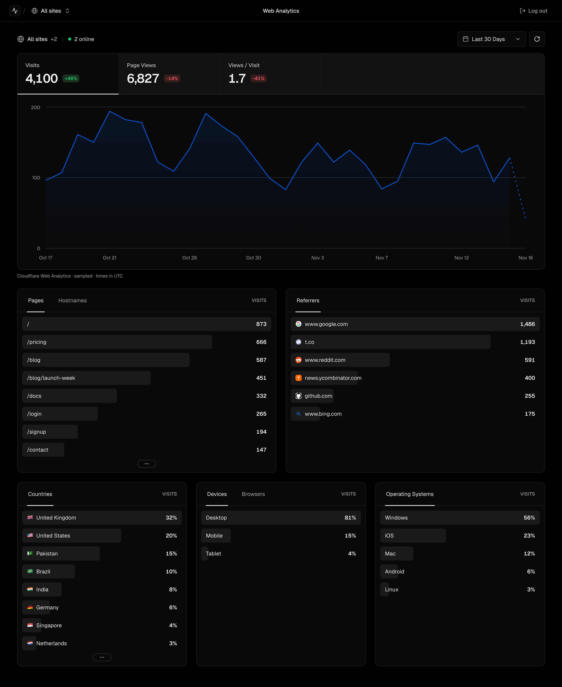
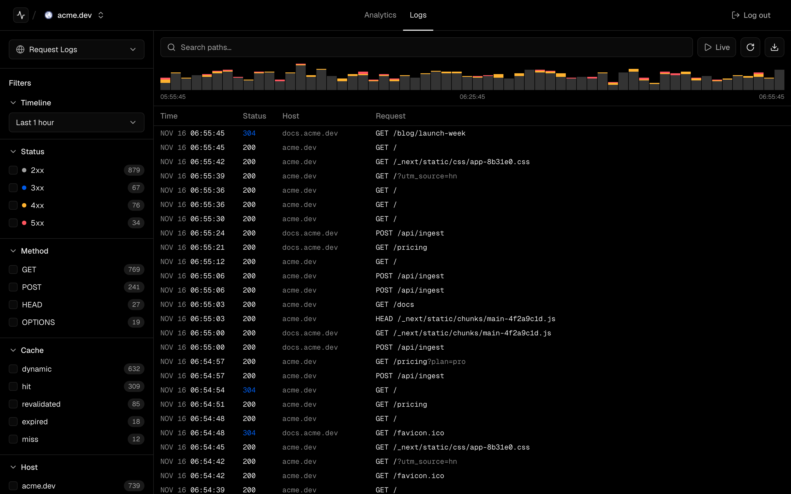

# cf-analytics

A Vercel-style analytics dashboard for **Cloudflare Web Analytics**. It runs as a single Cloudflare Worker that you deploy to your own account. You sign in with a Cloudflare API token and get visits, page views, top pages, referrers, countries, devices, browsers and operating systems for every Web Analytics site in your account, with one site switcher. A Logs view, modeled on Vercel's, shows the HTTP requests hitting each proxied site and the runtime logs of every Worker in the account.

[](https://deploy.workers.cloudflare.com/?url=https://github.com/grokified/cf-analytics)
[](LICENSE)





## Why

Cloudflare Web Analytics is free, cookie-less and privacy-friendly, but its dashboard is spread across zones and accounts. cf-analytics puts all of your sites behind one switcher in a layout modeled on Vercel Analytics. It reads Cloudflare's GraphQL Analytics API directly, so nothing new gets added to your sites and no data is stored anywhere.

## Features

- **Every site in one place.** Lists all Web Analytics sites across every account your token can read, plus an "All sites" view for each account.
- **Visits, page views and views per visit**, each with the change against the previous period of the same length.
- **Time ranges** of 24 hours (hourly), 7 days, 30 days and 3 months (daily). The bucket that is still in progress is drawn dashed.
- **Breakdowns:** pages, hostnames, referrers, countries (with flags), devices, browsers and operating systems. Each panel opens a searchable full list.
- **Online now:** visits in the last 5 minutes.
- **Request logs:** every HTTP request to a proxied site, with time, status, host, method and path. Filter by status class, method, cache status and host, search paths, and choose a range from 30 minutes to 7 days. A stacked histogram shows 2xx–3xx, 4xx and 5xx over time. Clicking a row opens a details sheet with the request, client (country, device, browser, ASN) and edge (cache, origin status and time, security action) fields.
- **Runtime logs:** `console.log` output, errors and invocations from the Workers in the account, through Workers Observability. Filter by level, Worker and outcome, run a full-text search, and open the raw event in the details sheet.
- **Live mode** refreshes the logs every 5 seconds. You can also load older rows or download what's on screen as JSON.
- **Shareable state:** the account, site, range, metric, log view and filters live in the URL.
- **Sign in with a Cloudflare API token.** The token is encrypted (AES-GCM) into an `HttpOnly`, `Secure` cookie, so page scripts can never read it.
- Responsive down to phone width.

## Deploy

### One click

Click **Deploy to Cloudflare** above. Cloudflare copies this repository to your GitHub account, asks for one secret, then builds and deploys the Worker:

| Secret | Value |
| --- | --- |
| `SESSION_SECRET` | Any long random string. Generate one with `openssl rand -hex 32`. |

### From the command line

Requires [Bun](https://bun.sh) 1.3 or later.

```bash
git clone https://github.com/grokified/cf-analytics.git
cd cf-analytics
bun install
bunx wrangler login
bunx wrangler secret put SESSION_SECRET   # paste the output of: openssl rand -hex 32
bun run deploy
```

Wrangler prints your URL, for example `https://cf-analytics.<your-subdomain>.workers.dev`.

## Sign in

Create a **user API token** with these read-only permissions:

| Scope | Permission | Used for |
| --- | --- | --- |
| Account | Account Analytics: Read | Querying Web Analytics through the GraphQL API |
| Account | Account Settings: Read | Listing your Web Analytics sites |
| Zone | Analytics: Read | Request logs (all zones, or only the ones you want) |
| Account | Workers Observability: Edit | *Optional.* Runtime logs. Cloudflare only lets you query logs with Edit; the dashboard never writes anything. |

[Create this token with the three read permissions pre-filled](https://dash.cloudflare.com/profile/api-tokens?permissionGroupKeys=%5B%7B%22key%22%3A%22account_analytics%22%2C%22type%22%3A%22read%22%7D%2C%7B%22key%22%3A%22account_settings%22%2C%22type%22%3A%22read%22%7D%2C%7B%22key%22%3A%22analytics%22%2C%22type%22%3A%22read%22%7D%5D&accountId=*&zoneId=all&name=Web%20Analytics%20Dashboard), then add Workers Observability: Edit by hand if you want runtime logs. The login screen links there too. If the token lacks a logs permission, the Logs view says which one to add. Paste the token into the login screen; the session lasts 7 days.

Your sites need [Cloudflare Web Analytics](https://developers.cloudflare.com/web-analytics/) turned on, either automatically for proxied sites or with the JS beacon.

## Local development

```bash
bun install
cp .dev.vars.example .dev.vars   # then put a random string in SESSION_SECRET
bun run dev
```

Open `http://localhost:5173`. To work on the UI without a token, open `http://localhost:5173/?demo` to load generated sample data. Demo mode only exists in the dev server and is removed from production builds.

| Script | What it does |
| --- | --- |
| `bun run dev` | Vite dev server with the Worker running in workerd |
| `bun run build` | Type-check the app and Worker, then build both |
| `bun run deploy` | Build, then `wrangler deploy` |
| `bun run lint` | oxlint |
| `bun run cf-typegen` | Regenerate `worker-configuration.d.ts` after changing `wrangler.jsonc` |

## How it works

One Worker serves both the React single-page app (as [static assets](https://developers.cloudflare.com/workers/static-assets/)) and a small JSON API under `/api/*`:

| Endpoint | Purpose |
| --- | --- |
| `POST /api/login` | Checks the token against the Cloudflare API, then sets the encrypted session cookie |
| `POST /api/logout` | Clears the cookie |
| `GET /api/me` | Lists the accounts the token can read |
| `GET /api/sites` | Lists Web Analytics sites (`/accounts/{id}/rum/site_info/list`) |
| `GET /api/analytics?account=&site=&range=` | Runs one GraphQL query and returns totals, the time series and every breakdown |
| `GET /api/logs/requests?zone=&range=` | Request logs for one zone: a page of rows, the histogram and the filter counts |
| `GET /api/logs/runtime?account=&range=` | Runtime logs for every Worker in an account, in the same shape |

Each dashboard load is a single GraphQL request to the `rumPageloadEventsAdaptiveGroups` dataset. Aliases fetch the totals, the previous period, online visitors, the series and seven breakdowns in one round trip. The request and response types live in [`shared/api.ts`](shared/api.ts), which both the Worker and the UI import.

Request logs are also one GraphQL request, to the zone's `httpRequestsAdaptive` (rows) and `httpRequestsAdaptiveGroups` (histogram and filter counts) datasets. Runtime logs come from the [Workers Observability query API](https://developers.cloudflare.com/workers/observability/logs/workers-logs/), with one call for the events, one for the histogram and one for each filter. Both endpoints take the filters as comma-separated query parameters (`status=4xx,5xx`, `level=error`), plus `q` for search and `before` for paging. Pages are 100 rows, newest first.

POST requests must send `Content-Type: application/json` and a same-origin `Origin` header. The cookie is `SameSite=Lax`.

## What Cloudflare's data can and can't show

- **Visits, not unique visitors.** Cloudflare Web Analytics sets no cookies, so it counts visits: page views whose referrer is another site or empty. There is no unique-visitor metric.
- **No bounce rate.** Cloudflare has no session data, so the third metric is views per visit instead.
- **No UTM parameters.** Cloudflare drops query strings from page paths.
- **Sampled data.** Large sites and long ranges come back from Cloudflare's adaptive sampling, so you may see rounded numbers such as 81,200.
- **History.** Cloudflare keeps about 6 months of data and allows at most 93 days per query, which is why the longest range is 3 months.
- **Request logs are sampled too.** They come from Cloudflare's analytics, not from Logpush, so on busy sites you see a representative sample rather than every request. They only exist for sites proxied through Cloudflare. A site that only uses the JS beacon has no request logs. By default the view shows visitor traffic; untick *Visitors only* to include Worker subrequests.
- **Free plan fields.** Referrer, colo and time to first byte aren't available to free zones, so the details sheet leaves them out.
- **Runtime logs need Workers Logs.** Turn on `observability` in each Worker's Wrangler config. Cloudflare keeps these logs for 3 days on the Workers Free plan and 7 days on Paid.

## Project structure

```text
cf-analytics/
├── worker/
│   ├── index.ts         # routes, CSRF checks, handlers
│   ├── cloudflare.ts    # REST calls, GraphQL query builder and response shaping
│   ├── logs.ts          # request and runtime log queries
│   └── session.ts       # AES-GCM session cookie
├── shared/api.ts        # API contract shared by Worker and UI
├── src/
│   ├── App.tsx          # sign-in gate, Analytics/Logs routing
│   ├── Login.tsx
│   ├── Header.tsx       # site switcher, Analytics/Logs tabs, log out
│   ├── Dashboard.tsx    # URL state, data fetching, toolbar
│   ├── Overview.tsx     # metric tabs and chart
│   ├── Breakdowns.tsx   # breakdown panels and "view all" dialog
│   ├── Logs.tsx         # Logs page: URL state, fetching, live mode, paging
│   ├── LogsFilters.tsx  # view selector, timeline and filter checkboxes
│   ├── LogsTable.tsx    # histogram and log rows
│   ├── LogDetails.tsx   # details sheet
│   ├── demo.ts          # sample data for ?demo (dev only)
│   └── components/ui/   # shadcn/ui components
├── wrangler.jsonc
└── vite.config.ts
```

## Stack

Bun, React 19, Vite with [`@cloudflare/vite-plugin`](https://developers.cloudflare.com/workers/vite-plugin/), Tailwind CSS v4, [shadcn/ui](https://ui.shadcn.com) (Radix), Recharts, the Geist font, and Cloudflare Workers.

## Hosted instance

You can try it at [cf-analytics.imfaisii009.workers.dev](https://cf-analytics.imfaisii009.workers.dev) with your own token. Signing in there sends your read-only token to a Worker someone else runs, so for regular use deploy your own copy with the button above.

## Notes

This project isn't affiliated with Vercel or Cloudflare. The layout is inspired by Vercel Analytics; no Vercel code or assets are used.

## License

[MIT](LICENSE)
